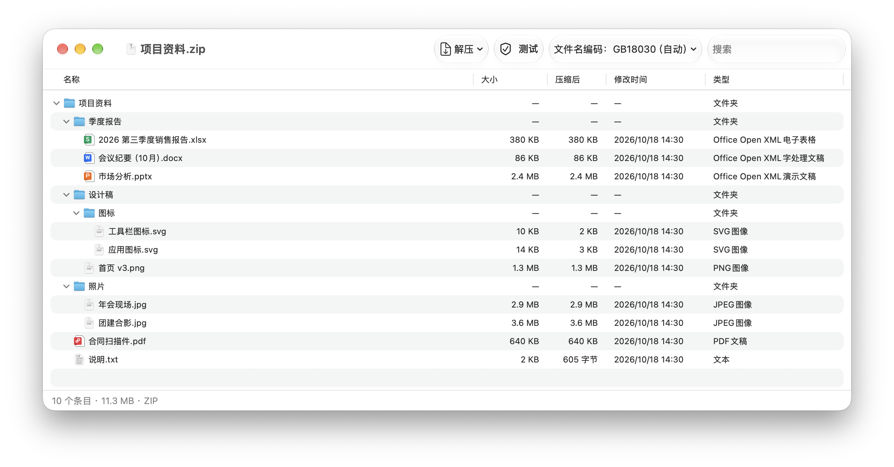
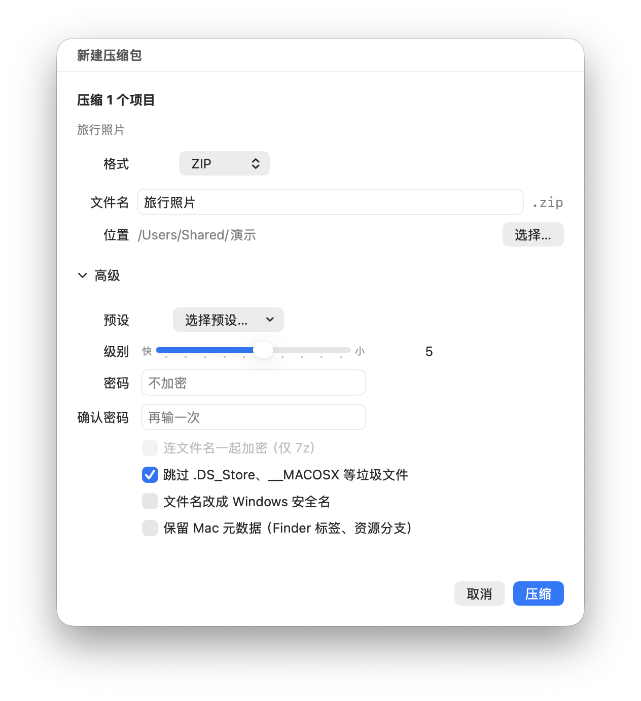
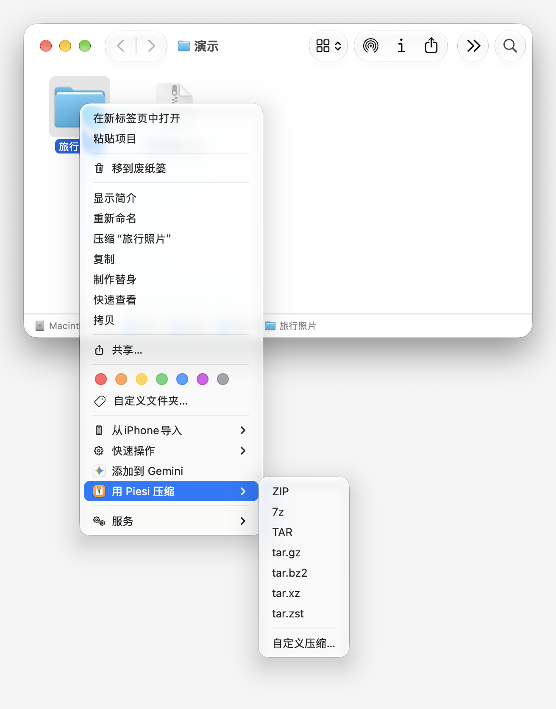
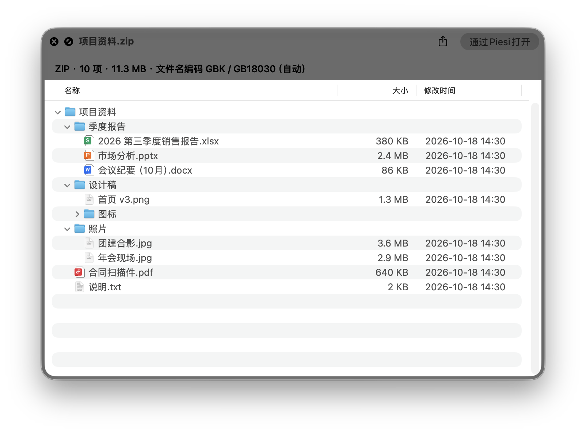

# Piesi

默认干净、中文不乱码、能像 Finder 一样浏览压缩包的现代原生 Mac 压缩工具。
Rust 核心可跨平台，开源（MIT OR Apache-2.0）。

Windows / Linux 提供 x64 命令行安装包（Windows Setup / ZIP、Linux DEB / RPM / tar.gz），
下载 `Piesi CLI` Release，安装与使用说明见 [CLI 帮助](docs/cli.md)。图形客户端目前仅支持 macOS。

- 设计方案：`docs/design.md`
- 开发规则：`CLAUDE.md`
- 发版规范：`docs/release.md`

## 截图

**浏览窗口**：Windows 中文版打的 GBK 文件名包，自动识别编码，不乱码；可搜索、Quick Look、拖出、校验。



<table>
  <tr>
    <td width="50%" valign="top"><b>压缩对话框</b>：直接选格式，级别、密码、清理垃圾文件等收在「高级」里。<br></td>
    <td width="50%" valign="top"><b>Finder 右键菜单</b>：选格式直接压缩，也可以自定义。<br></td>
  </tr>
</table>

**Quick Look**：在 Finder 里按空格预览压缩包条目树，不解压。



## 现状（v1.0 功能已齐，待发版）

核心引擎已可用，命令行 `piesi` 可以：

```sh
piesi detect 包.zip                 # 识别格式
piesi list 包.zip                   # 列目录，自动识别文件名编码；--encoding gb18030 可手动指定
piesi list 包.zip --json            # 机器可读输出（含 id、编码置信度）
piesi x 包.zip                      # 解压到包旁边，智能建文件夹、冲突改名、跳过 __MACOSX/.DS_Store
piesi x 包.7z -o 目标目录 -p 密码    # 指定目录与密码；--id 3 --id 7 只解指定条目
piesi t 包.zip                      # 校验（解码 + CRC，不写盘），损坏或密码错误时退出码非 0
piesi a 输出.zip 目录 文件…          # 创建 zip（UTF-8 + bit 11 + NFC，多线程）
piesi a 输出.zip --mac-metadata 目录  # 「Mac 专用」zip：标签、资源分支、Finder 信息写成 __MACOSX/._ 条目，ditto / 归档工具可还原
piesi a 输出.tar.gz --mac-metadata 目录  # tar 同理：写 ._ 条目 + PAX xattr，系统 tar（含 --xattrs）、GNU tar --xattrs 可还原
piesi a 输出.zip -p 密码 目录         # AES-256 加密 zip（WinZip AE-1/AE-2 格式，7-Zip / WinZip / Keka 可解）；7z 同样用 -p，--encrypt-names 连文件名一起加密
piesi a 输出.7z --level 7 目录      # 创建 7z（多线程 LZMA2，solid 块 128 MB）
piesi a 输出.tar.zst 目录           # tar / tar.gz / tar.bz2 / tar.xz / tar.zst
piesi a 文件.txt.gz 文件.txt        # 单文件 gz / bz2 / xz / zst
```

macOS app（`apple/`）：双击压缩包直接解压到旁边（⌥ 双击或 Finder 右键「用 Piesi 查看」进浏览窗口）、浏览窗口（搜索、Quick Look、拖出、校验、编码切换）、压缩对话框（直接选择格式，特殊用途预设收进高级选项）、设置、Finder 右键菜单（选格式直接压缩，另可自定义；需在系统设置里打开 Piesi 扩展；另有「服务」菜单）、设为默认解压工具、快捷指令（App Intents：「用 Piesi 解压」「用 Piesi 压缩」）。界面有简体中文、繁体中文、English、日本語，其它语言回落到英文。
Quick Look 扩展：在 Finder 里按空格预览 zip / 7z / rar / tar 的条目树（只读索引，不解压）。

支持读取：zip（zip64、AES、ZipCrypto、`.zip.001`、`.z01` 分卷）、7z（BCJ/BCJ2/ARM64、solid、头加密、`.7z.001`）、rar（v4/v5、分卷、加密）、tar 及 tar.gz/bz2/xz/zst、单文件 gz/bz2/xz/zst。
支持创建：zip（可 AES-256 加密）、7z（可 AES-256 加密、加密文件名）、tar、tar.gz、tar.bz2、tar.xz、tar.zst，以及单文件 gz、bz2、xz、zst。macOS app 与 Quick Look 扩展在 `apple/`。

压缩调度、格式限制和验证方式见 [压缩领域说明](docs/compression.md)。

## 开发

```sh
cargo test --workspace            # 单元 + 集成 + 语料回归
scripts/smoke.sh                  # 端到端：与 7zz / unzip / bsdtar 交叉验证
scripts/bench.sh mixed            # 与 7zz 对比耗时与峰值内存（结果在 bench/results.md）
scripts/build-core.sh --arch native && (cd apple && xcodegen generate && xcodebuild -scheme Piesi build)
```

### 模糊测试（cargo-fuzz）

解析不可信压缩包是主要攻击面，`fuzz/` 里是 libFuzzer 目标 `open_any`：任意字节当压缩包打开、列目录、规划、校验，只允许报错，不允许 panic / 死循环 / 吃光内存。

```sh
cargo install cargo-fuzz          # 一次
fuzz/seed.sh                      # 用测试夹具生成种子语料
cargo +nightly fuzz run open_any -- -max_len=65536 -timeout=10 -rss_limit_mb=2048
```

发现的崩溃样本在 `fuzz/artifacts/open_any/`，复现：`cargo +nightly fuzz run open_any fuzz/artifacts/open_any/<文件>`。
