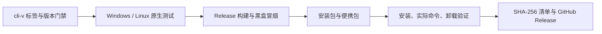

# Windows / Linux 命令行版

Piesi CLI 使用与 macOS 客户端相同的 Rust 压缩引擎，可识别格式、列目录、压缩、解压和校验压缩包。
Windows / Linux 安装包只包含命令行程序，不包含 macOS 的浏览窗口、Finder 扩展或自动更新。

## 下载与安装

在 GitHub Releases 中选择 `Piesi CLI`，不要使用 macOS 的 DMG。
当前提供 x86_64（Windows 中称 x64，Debian 中称 amd64）安装包。

| 系统 | 文件 | 安装方式 |
|---|---|---|
| Windows 10/11 x64 | `piesi-cli-<版本>-windows-x86_64-setup.exe` | 双击安装，仅安装到当前用户目录，无需管理员权限 |
| Windows 10/11 x64 | `piesi-cli-<版本>-windows-x86_64.zip` | 解压后在 PowerShell 中执行 `./piesi.exe --help` |
| Debian / Ubuntu x86_64 | `piesi-cli_<版本>_amd64.deb` | `sudo apt install ./piesi-cli_<版本>_amd64.deb` |
| Fedora 等 RPM 系统 x86_64 | `piesi-cli-<版本>-1.x86_64.rpm` | `sudo dnf install ./piesi-cli-<版本>-1.x86_64.rpm` |
| Linux x86_64 便携版 | `piesi-cli-<版本>-linux-x86_64.tar.gz` | 解压后执行 `./piesi --help`，或用 `sudo install -m755 piesi /usr/local/bin/piesi` 安装 |

Linux 包在 Ubuntu 22.04 上构建，要求 glibc 2.35 或更新版本，以及系统的 libgcc、libstdc++。
不适用于 Alpine 的 musl 环境。DEB / RPM 元信息包含自动分析的运行库依赖，包管理器会检查它们；
旧发行版不能通过忽略依赖获得兼容性。
Windows 安装包静态链接 MSVC 运行时，无需单独安装 Visual C++ Redistributable。

Windows 安装默认勾选「Add Piesi CLI to the current user's PATH」。安装后重新打开终端，执行 `piesi --version`。
如果没有添加 PATH，默认程序位置为 `%LOCALAPPDATA%\Programs\Piesi CLI\piesi.exe`。
Windows 安装程序暂未配置 Authenticode 签名。

发行页同时提供 `SHA256SUMS.txt`。Linux 可用 `sha256sum --check SHA256SUMS.txt` 校验下载文件；
Windows 可用 `Get-FileHash ./下载的文件 -Algorithm SHA256` 与清单比较。
只下载部分文件时，Linux 校验命令加 `--ignore-missing`。

## 常用命令

```sh
piesi --version
piesi detect archive.zip
piesi list archive.zip
piesi list archive.zip --json
piesi x archive.zip -o output
piesi x archive.7z -p password -o output
piesi t archive.zip
piesi a archive.zip folder
piesi a encrypted.zip -p password folder
piesi a encrypted.7z -p password --encrypt-names folder
piesi a archive.tar.zst folder
```

支持读取 ZIP、7z、RAR、tar、gz、bz2、xz、zst，以及已支持的分卷与加密变体。
可创建 ZIP、7z、tar.gz、tar.xz、tar.zst；不能创建 RAR。
文件名编码默认自动识别，必要时用 `--encoding gb18030` 手动指定。
默认跳过 `__MACOSX`、`.DS_Store` 等垃圾；同名文件默认改名，可用 `--overwrite` 或 `--skip` 调整。
`--mac-metadata` 在 Windows / Linux 上不读取 macOS 元数据；Unix 权限位仅在 Unix 系统还原。
Windows 创建符号链接需要开发者模式或相应权限，失败时跳过链接并输出警告；悬空目录链接无法推断目录类型，按文件链接尝试。
Windows 上游 unrar 不支持还原 RAR4 的符号链接，此类链接会跳过并告警；RAR4 普通文件和 RAR5 链接不受此限制。

## 卸载与更新

Windows 在系统的「已安装的应用」中卸载 Piesi CLI，安装程序会移除自己添加的 PATH 项。
DEB 使用 `sudo apt remove piesi-cli`，RPM 使用 `sudo dnf remove piesi-cli`。
便携版删除解压目录即可；手动复制到 `/usr/local/bin` 的程序需手动删除。
CLI 不自动更新，下载新版安装包覆盖安装；便携版替换程序前先退出正在运行的命令。

## 开发与发版

核心领域、格式驱动和安全解压逻辑在 `crates/piesi-core`；`crates/piesi-cli` 只做参数和输出转换。
文件系统边界 `fs.rs` 根据目标平台还原权限、创建链接；仅 macOS 编译 xattr 依赖。
打包不改变 CLI 行为，安装程序负责文件布局和 Windows 当前用户 PATH。



`.github/workflows/cli-release.yml` 在分支推送及 PR 上验证两个平台，只有 `cli-v<版本>` 标签发布。
`scripts/package-cli.py` 从 Cargo.toml 读取唯一版本并核对 `piesi --version`，调用 Inno Setup、dpkg-deb 和 rpmbuild。
`scripts/smoke-cli.py` 对实际二进制验证中文路径、各创建格式、ZIP/7z 加密、RAR4/RAR5 读取与落盘、错误密码、损坏输入和路径穿越防护。
CI 对 Windows 安装卸载及 PATH、Ubuntu DEB 安装卸载、Fedora 容器 RPM 安装卸载做实际验证，任一步失败都不会发布。
标签必须位于 main 且不含开发标记；CLI Release 不设为 latest，以保留 macOS Sparkle 的更新源。
版本推进和标签不可变规则见 `release.md`。
