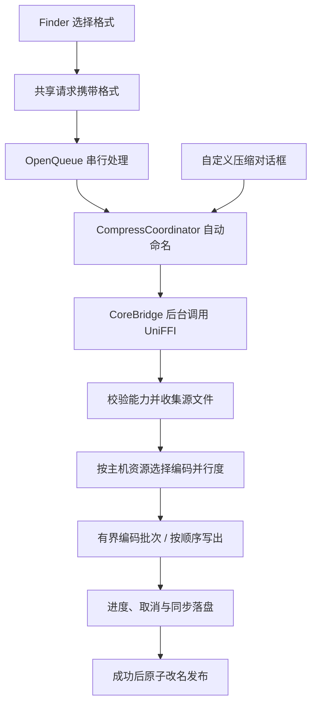

# 压缩创建与性能调度

普通压缩以格式为入口。Finder「用 Piesi 压缩」子菜单选择格式后，直接在源目录创建；「自定义压缩…」、应用内新建和 Services 打开对话框。对话框默认只显示格式、文件名和位置，高级选项整行可点击并支持键盘操作，内容可滚动。四个特殊用途预设只放在高级菜单中，现有快捷指令预设继续可用。



## 格式规则

| 格式 | 输入 | 加密 | Mac 元数据 |
|---|---|---|---|
| ZIP | 文件、目录、符号链接 | AES-256 | AppleDouble |
| 7z | 文件、目录、符号链接 | AES-256，可加密文件名 | 不支持 |
| TAR、tar.gz、tar.bz2、tar.xz、tar.zst | 文件、目录、符号链接 | 不支持 | AppleDouble + PAX |
| gz、bz2、xz、zst | 单个普通文件 | 不支持 | 不支持 |

创建格式共 11 种，RAR 继续只读。CLI 优先采用 `--format`，否则按输出扩展名推断；支持 tgz / tbz / tbz2 / txz / tzst 别名。裸压缩流不能打包多个文件、目录或符号链接，界面按输入隐藏这些格式，引擎也校验。非 ZIP / 7z 格式传入密码会明确拒绝。切换到不支持密码的格式会清空对话框中的密码，避免忽略密码后误以为输出已加密。

Finder 的格式子菜单以 `NSMenuItem.tag` 携带格式索引；Finder 跨进程回传不保留 `representedObject`，不能用它接收选择。扩展使用不依赖引擎的 `CompressionFormat` 传递格式，主应用转换为 UniFFI 的 `CreateFormat`；旧请求没有格式字段时继续打开自定义对话框。普通创建默认保留原文件名；Windows 安全名转换仅通过高级选项或预设启用。同名输出自动加序号，源文件保留。

## 主机资源与吞吐

`sys.rs` 集中查询资源：macOS 直接调用 `sysctlbyname` / `host_statistics64`，不启动子进程，Linux 使用 `/proc/meminfo`，Windows 使用 `GlobalMemoryStatusEx`。CPU 数使用 Rust 的 `available_parallelism`；每次创建重新查询当前可用内存。

编码内存预算为 `min(物理内存 / 2, 当前可用内存 × 3/4)`，最低 64 MiB。自动线程数受 CPU、内存预算和实际输入块数共同限制。显式 `--threads` 同样受内存预算约束，避免通过增加线程触发交换空间而降低吞吐；编码器至少需要一个工作线程。

- ZIP 小文件并行编码；至少 8 MiB 的文件使用按偏移并行读取、4 MiB 独立块编码、顺序写入的管道，直接进入最终文件，再回填本地头 CRC 和长度，取消临时压缩文件与二次转写。只使用一个 Rayon 池，按约 32 MiB/worker 约束内存；编码结果通道最多排队一个批次。所有输入与编码缓冲仅在本次创建中存活，结束后释放。
- CPU 密集的 DEFLATE 使用可用核心；自动原样存储路径最多使用 4 个 I/O worker，避免实测中全核读入造成的额外调度、内存流量及预读堆积，显式 `--threads` 可覆盖。消费者留在池外，单线程和输出失败时都不会卡在通道上。
- 并行 DEFLATE 使用无终止位、字节对齐的 Sync Flush 块，末尾补结束块；CRC 按块顺序合并。不可压缩块直接写 DEFLATE 原样块，并通过向量写入避免拼接副本。输出仍是标准 ZIP，AES 在整个条目的压缩数据外包装一次。
- ZIP 级别 1–6 对至少 1 MiB 的文件取头、中、尾各 64 KiB 快速试压，抽样收益不足 1% 时直接存储。PNG、JPEG、MP4、WebM 同时检查媒体标记与主体抽样，避免可压缩文件头误导主体判断；后续编码块也独立抽样。高压缩级别 7–9 始终完整尝试。抽样可能放弃未采到的局部压缩收益，这是普通级别的速度取舍；基准必须同时报告包大小。
- GZip / BZip2 按 4 MiB 独立成员并行，再按顺序写出标准多成员流；单文件和 TAR 外壳共用实现。批次内存有界，空输入仍输出合法压缩成员。
- XZ 根据输入量设置快速级别 1–3 的独立块大小，用 liblzma `memusage()` 逐步降低线程数以满足内存预算；4–9 保留编码器默认块大小。
- Zstandard 使用库的原生多线程；7z 在独立 solid 块与块内 LZMA2 线程间共享同一 CPU/内存预算。独立块保留字典大小下限，避免通过破坏字典复用来制造速度提升。

进度按已读取的输入字节上报，编码及最终写出仍可能在达到 100% 后进行短暂收尾。ZIP 读取及输出循环都检查取消，回退到原样存储时不重复计数。引擎在同目录的待完成文件中直接生成结果，成功后原子改名，不复制归档数据。失败、取消或验证错误会回收待完成文件并保留已有目标；FFI 不再无条件删除目标路径。ZIP 没有额外的临时压缩数据中转。

## 验证

核心回归包括单/双线程 ZIP、大文件中途进度与取消、抽样存储与 AES、并行 DEFLATE 的 CRC/尾块及 7-Zip 互通、新格式回读、多成员 GZip/BZip2 与空输入、TAR 目录/空文件/链接、无效输入和不支持密码时拒绝创建。

```sh
cargo test --workspace --locked
cargo clippy --workspace --all-targets -- -D warnings
scripts/smoke.sh
python3 apple/scripts/strings-lint.py
scripts/build-core.sh --arch native
cd apple && xcodegen generate
xcodebuild -project Piesi.xcodeproj -scheme Piesi -configuration Debug -derivedDataPath build build
```

UI 验证需检查默认格式入口、高级文字及整行点击、重复收放、所有选项和操作按钮可达、预设切换、密码不匹配阻止提交，以及实际生成压缩包。性能数据需记录同一输入、级别、线程数、输出大小和校验结果；不能由一个媒体样本推断所有数据集或平台的速度。

Finder 菜单与旧请求兼容回归：

```sh
swiftc -swift-version 6 apple/PiesiFinder/FinderRequest.swift apple/PiesiFinder/FinderSync.swift apple/tests/CompressionMenuTests.swift -o /tmp/piesi-menu-tests
/tmp/piesi-menu-tests
```

可复算基准（每个输入预热一次、默认测五次，7-Zip 与源文件 CRC 另行校验；校验不计入压缩耗时）：

```sh
python3 scripts/bench-create.py target/release/piesi /path/to/input.mp4 --baseline /path/to/baseline-piesi --sevenzip /opt/homebrew/bin/7zz --output bench/create.json
```
